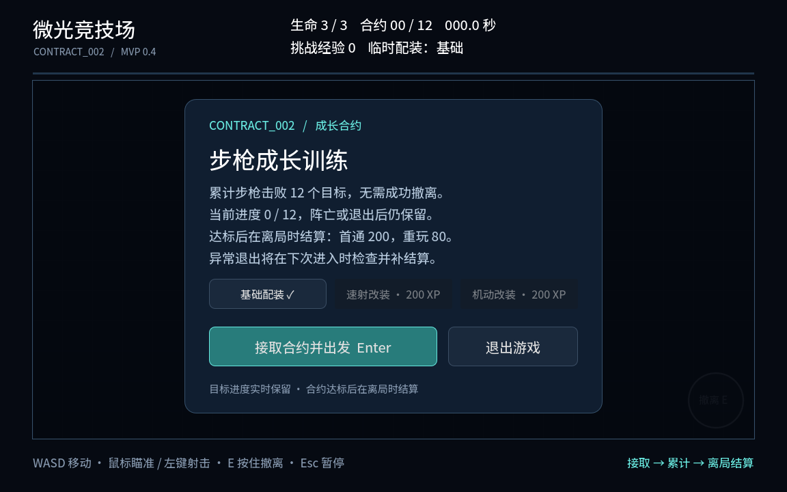

# 构筑挑战合约：设计与可玩原型

个人系统策划练习。基于系统研究，为喜欢射击、搜集和成长、但希望降低部分参与负担的玩家，设计可独立推进的合约与模式内成长。

[研究依据](../marathon_analysis/README.md) · [试玩下载页](https://github.com/Djunine/game_design_portfolio/releases) · [Godot源项目](godot/README.md)

## 阅读文件

1. [主方案 PDF](构筑挑战合约_主方案.pdf)：目标、通用机制、两份合约及取舍。
2. [执行样例 PDF](构筑挑战合约_执行样例.pdf)：配置、界面与验收预期。
3. [网页正文与按钮规则模拟](构筑挑战合约系统设计_执行附件版.html)：下载后用浏览器打开；不是游戏Demo。
4. [合约规则基准](data/合约规则基准.json)：文档、网页和原型使用的条件对应。
5. [规则对应与裁剪范围](docs/规则对应与验证.md) · [验证摘要](docs/验证摘要.md)。

## 同一系统，不同合约条件

| 合约 | 条件 | 当前展示范围 |
|---|---|---|
| CONTRACT_001 步枪火力校准 | 本局击败12个且本人成功撤离；未完成不保留本局计数 | 文档、网页规则模拟 |
| CONTRACT_002 步枪成长训练 | 跨局累计12个，无需成功撤离；达标后离局结算 | 文档、网页模拟、可玩Demo 0.4 |

通用流程为：接取 → 按具体合约条件记录进度 → 结束对局后检查 → 满足条件才发奖。所有结束方式进入检查，不代表所有合约都满足完成条件。

标准示例首通为80基础+120首次额外经验，之后每次完成80。已有经验与解锁保留。200经验阶段在原型中提供速射/机动改装样例。

## 试玩

从Releases下载Windows包，完整解压后运行NeonArena.exe，保留同目录NeonArena.pck。

WASD / 方向键移动，鼠标瞄准，按住左键射击；Esc / P暂停。右下撤离区按住E可离开，但002不以成功撤离为完成条件。阵亡、主动退出均进入结束结算；异常退出在下次进入时根据最后已保存记录恢复处理。

0.4采用带合约标识的新档，不自动导入旧版存档。存档progress.json位于游戏目录，请在可写文件夹运行。

## 实现边界与贡献

当前只演示单人、标准难度和002。001、多难度、多人助攻、完整搜集、500/900阶段及正式经济接入未在游戏中提供。

本人参与需求范围、条件差异、实时记录与离局结算等取舍，并提出最小化开火与命中反馈。程序、文稿整理和自动检查有AI辅助。个人练习不等同商业上线、真实玩家测试或正式跨岗位联调；人工验收尚待补充。

[返回仓库首页](../../README.md)
